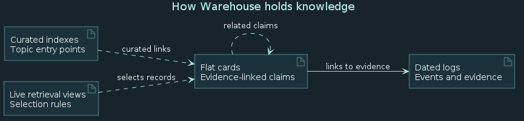

# About Memory Warehouse

Memory Warehouse is a public window into a local-first memory system shared
by a person and their agents. The private source uses plain Markdown so that
knowledge stays readable, portable, and independent of a particular tool.

The warehouse is a metaphor: many small acts of collecting, sorting, and
connecting make knowledge easier to find again. This illustration is an
exploratory image, not a literal depiction of the system.

## From evidence to understanding

- **Logs** preserve dated events, observations, ideas, and sources.
- **Cards** express small, reusable claims and link back to their evidence.
- **Indexes and retrieval views** provide different paths through the material.
- **Skills** hold repeatable procedures for people and agents.

[View the editable PlantUML diagram source](assets/warehouse-memory-model.puml).
The diagram is adapted from an exploration of Warehouse's log, card, and index
relationships. Indexes are maps, not containers: cards remain independent files.

## What appears here

The source Warehouse is private. This public site is a separate, curated
selection of records reviewed for sharing. It is not a complete mirror of the
private memory system. Public pages are generated from Markdown; the source
documents remain the underlying records.
